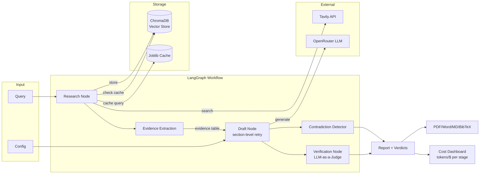

# Deep Research AI Agent

Generate comprehensive research reports on any topic using AI-powered web search and synthesis.

[](https://github.com/saksham-jain177/agentic-deep-research/actions/workflows/test.yml)
[](LICENSE)
[](https://www.python.org/downloads/)
[](https://streamlit.io)

## Why this and not GPT-Researcher or ChatGPT Deep Research?

Those optimise for a readable report; this one optimises for a **defensible** one, and
measures the difference. It scores its own citations against a fixed 40-query gold set,
publishes the command that reproduces every number in this README, and prints the
coverage alongside the score — so a measurement over 4 recorded queries is labelled 10%,
not passed off as the whole benchmark. The visible consequence is the boring one that
matters: abstention is graded, contradictions are surfaced instead of averaged, and a
citation that does not establish its claim costs the run a point.

## Problem

Researching a topic thoroughly is time-consuming. You need to find sources, evaluate credibility, synthesize information, and format citations—all before you even start writing.

## Solution

This tool automates the research workflow:

1. **Search** — Queries Tavily API for relevant sources (filters out social media noise), with parallel variant queries and cross-encoder reranking
2. **Cache** — Stores results in ChromaDB with semantic search and smart TTL
3. **Extract** — Distills raw sources into a structured evidence table that grounds section prompts
4. **Synthesize** — LLM drafts structured reports in your chosen style; only failed sections are retried, not the whole report
5. **Export** — Download as PDF, Word, Markdown, or BibTeX

**Live demo:** the hosted app at [deep-research-ai-agent.streamlit.app](https://deep-research-ai-agent.streamlit.app/)
is currently behind a Streamlit Community Cloud sign-in wall, so it is not usable as a demo for
visitors. Two ways that do work, both free:

```bash
python stream_cli.py "impact of sugar on metabolic health" --deep --out report.md   # real run, your keys
python stream_cli.py --mock                                                         # offline demo, no keys at all
```

The first is the whole product in one command: it searches, drafts section by section with a live
verdict per section, and writes a Markdown report to `report.md`. The second stubs the model so you
can see the streaming and verification protocol before spending a credit.

*(A recorded 60-second GIF embedded here would convert more visitors than either URL, and cannot
rot. Tracked in [ROADMAP.md](ROADMAP.md), P1.)*

## Output Quality Guarantees

Every generated report includes:
- **Verification Summary** — an LLM-as-a-Judge pass scores each section against its sources
  (supported / partially_supported / unsupported), lists unverified claims, and measures
  inline-citation coverage.
- **Conflicting Evidence** — claims that conflict across sources are detected and surfaced
  explicitly with severity ratings, never silently averaged.

Both passes degrade gracefully: if no judge model is configured, deterministic heuristics
take over so generation never blocks.

## Evaluation

The verification pass tells you whether a report passed the agent's own check. `eval/`
tells you whether the agent is actually getting better: it runs a fixed 40-query gold set
through the pipeline and reports citation accuracy, grounding, abstention, and cost.

```bash
python -m eval validate                 # check the gold set
python -m eval run --mode replay        # deterministic run over committed fixtures
python -m eval report --results results/smoke.json --out results/smoke.md
```

Every `[n]` citation is scored through three cumulative tiers — the link resolves, the
page is on-topic, the page actually establishes the claim — so a failure is diagnosable
rather than just a low number. The gold set is stratified into verifiable facts,
synthesis, contested topics, and *unanswerable* queries, because an agent that invents an
answer to an unknowable question should score worse than one that abstains.

The harness is standard library only, needs no API keys, and is covered by its own
offline tests. It also provides `compare` for ablation runs (one variable at a time) and
`calibrate` for measuring LLM-judge agreement (Cohen's κ) against hand labels. Every pull
request replays the gold set against `main` and posts the delta table as a comment, so "this
change did not regress citation accuracy" is something you can read in the PR rather than take
on trust — and the comment says which rows replay cannot measure, and when a change to the scored
subset makes a delta meaningless. See [eval/README.md](eval/README.md) for the metric definitions
and methodology.

## Architecture



**Key Design Decisions:**

- **Two-node state machine**: Research and Draft are decoupled for testability
- **Vector memory with TTL**: News content expires in 3 days; evergreen in 30 days
- **Cross-encoder reranking**: Improves retrieval precision over raw similarity
- **Evidence table**: Sources are distilled into a structured evidence table that grounds section prompts and inline `[n]` citations (unsupported citations are dropped)
- **Parallel sub-queries**: Deep-research variant queries run concurrently via ThreadPoolExecutor
- **Section-level draft retry**: A validation failure regenerates only the failed section, not the whole report
- **Model fallback chain**: On rate limits or empty responses, drafting moves down `OPENROUTER_FALLBACK_MODELS` and stays there once a fallback works
- **Domain filtering**: Excludes Reddit, Twitter, TikTok by default

## Quick Start

```bash
# Clone
git clone https://github.com/saksham-jain177/agentic-deep-research.git
cd agentic-deep-research

# Install
pip install -r requirements.txt

# Configure
cp .env.example .env
# Edit .env with your API keys

# Run
streamlit run app.py

# Or one command, to a file
python stream_cli.py "your research query" --deep --out report.md

# Or see it work with no keys and no spend
python stream_cli.py --mock
```

**Required API Keys:**

| Key                  | Provider                               | Purpose       |
| -------------------- | -------------------------------------- | ------------- |
| `TAVILY_API_KEY`     | [tavily.com](https://tavily.com)       | Web search    |
| `OPENROUTER_API_KEY` | [openrouter.ai](https://openrouter.ai) | LLM inference |

**Optional:**

```bash
ENABLE_VECTOR_STORE=true       # Enable ChromaDB caching
PREFER_CACHE_RESULTS=false     # Prefer cached over fresh results
LLM_MAX_OUTPUT_TOKENS=4000     # Per-call LLM output token cap (default 4000)
TOKEN_BUDGET_PER_REPORT=12000  # Total prompt-token budget; low-confidence evidence is trimmed to fit
OPENROUTER_FALLBACK_MODELS=    # Comma-separated fallback model chain for rate limits / empty responses
```

## Configuration

| Setting         | Options                               | Default  |
| --------------- | ------------------------------------- | -------- |
| Writing Style   | Academic, Business, Technical, Casual | Academic |
| Citation Format | APA, MLA, IEEE, BibTeX                | APA      |
| Word Count      | 500–5000                              | 1000     |
| Language        | English, Spanish, German              | English  |
| Deep Research   | On/Off                                | Off      |

## Performance

| Metric             | Shallow Mode  | Deep Mode     |
| ------------------ | ------------- | ------------- |
| Sources fetched    | 5             | 20–30         |
| Avg. response time | ~15s          | ~45s          |
| Cache hit speedup  | 20–40% faster | 30–60% faster |
| Token usage        | ~2K–5K        | ~8K–15K       |

_Measured on typical queries with ChromaDB caching enabled._

## Non-Goals

This tool is **not**:

- A fact-verification engine — always verify critical claims
- Real-time streaming — uses section-by-section progress
- A citation authority — check sources before academic submission
- Optimized for legal/medical/financial advice

## Limitations

- **Rate limits**: Tavily free tier has daily limits
- **Model availability**: OpenRouter free models may be rate-limited (a fallback model chain mitigates this)
- **Citation accuracy**: Auto-generated citations should be manually verified; inline `[n]` references are checked against the evidence table, but underlying source quality is not judged
- **Language support**: Best results in English; ES/DE are functional but less tested

## Testing

The test suite (346 offline tests — all LLM and Tavily calls are mocked; the full suite runs without API keys) covers evidence extraction, citation validation and bibliography numbering, section-level draft retry, reranking, prompt-injection sanitization, log redaction, token budgets, output-token caps, model fallback, timeouts, and the evaluation harness — including the PR CI job that replays the gold set and posts the delta table.

The injection defence is tested end to end rather than at the regex level:
`tests/test_poisoned_page.py` feeds a poisoned page (real prose plus instruction-shaped text) through
fetch → evidence → draft → judge with a stub model that **obeys** the payload, and asserts what comes
out the other side. Two results worth stating plainly: a citation number the page invents (`[7]`
against a three-source table) is dropped and never reaches the bibliography, but the same page ranked
**first** by the real cross-encoder acquires a legitimate `[1]` and nothing in the drafting path
objects — position in a reference list is not a trust signal. That second finding is documented as a
limitation in [SECURITY.md](SECURITY.md), not quietly dropped.

```bash
pytest tests/ -v
```

## Project Structure

```
├── app.py                # Streamlit UI
├── main.py               # LangGraph workflow orchestration
├── research_agent.py     # Tavily search (parallel variants) + vector store integration
├── evidence_extractor.py # LLM-assisted distillation of sources into an evidence table
├── draft_agent.py        # LLM prompting, section generation, retries, fallback chain, cost controls
├── vector_store.py       # ChromaDB with cross-encoder reranking and TTL
├── sanitize.py           # Prompt-injection neutralization for fetched web content
├── log_redaction.py      # API key redaction from logs and session state
├── cost_estimator.py     # Token/cost estimation with uncertainty
├── citation_formatter.py # APA/MLA/IEEE/BibTeX generation with citation grounding
├── eval/                 # Benchmark harness: gold set, three-tier citation scoring, metrics
├── scripts/              # CI helpers, incl. the replay-eval PR comment
└── tests/                # Pytest suite: 346 tests, all offline (LLM/Tavily mocked)
```

## Contributing

1. Fork the repository
2. Create a feature branch (`git checkout -b feature/your-idea`)
3. Run tests (`pytest tests/ -v`)
4. Submit a pull request

See [CONTRIBUTING.md](CONTRIBUTING.md) for detailed guidelines,
[ROADMAP.md](ROADMAP.md) for what is planned and why,
[CHANGELOG.md](CHANGELOG.md) for what shipped, and
[SECURITY.md](SECURITY.md) for the threat model — including which of the protections here
are heuristics rather than guarantees.

## License

MIT License — use freely for personal or commercial projects.

---

**Questions?** [Open an issue](https://github.com/saksham-jain177/agentic-deep-research/issues).
